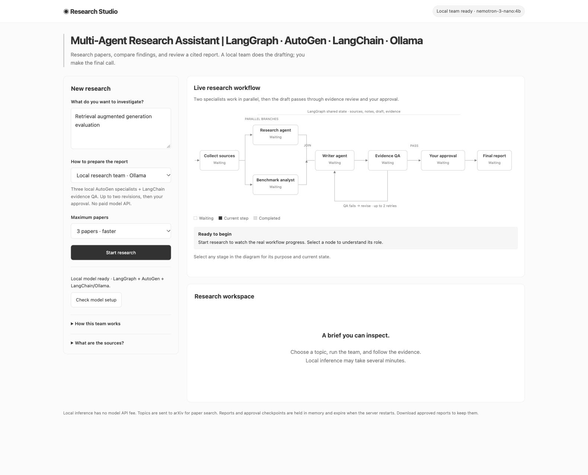
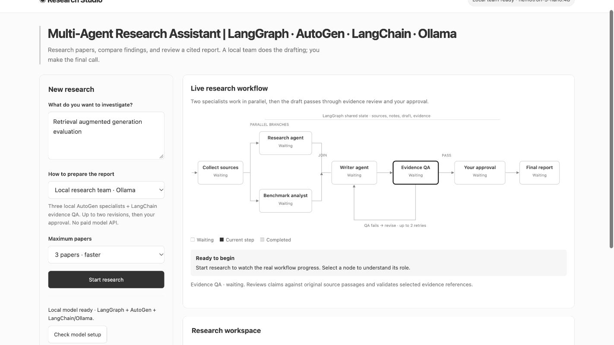
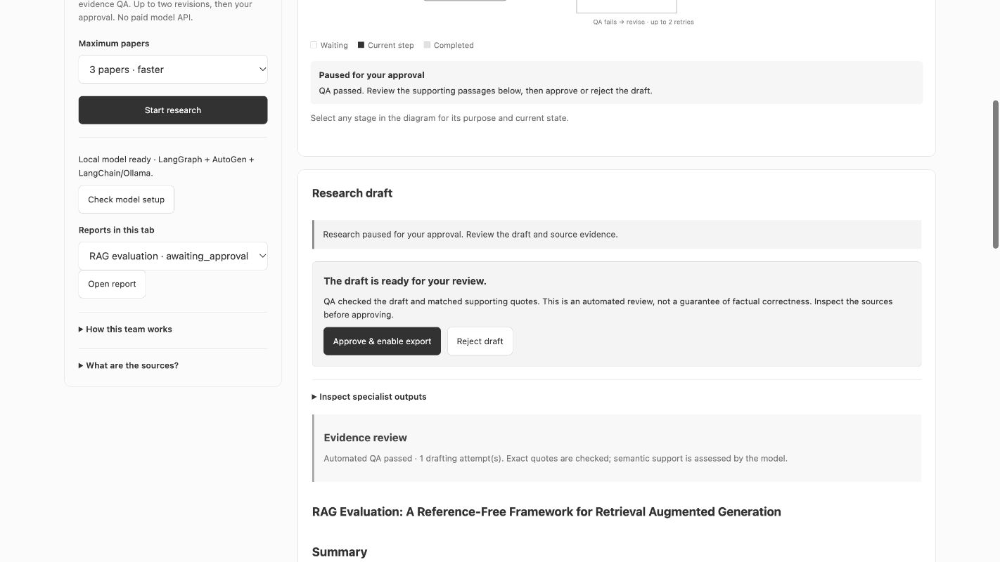
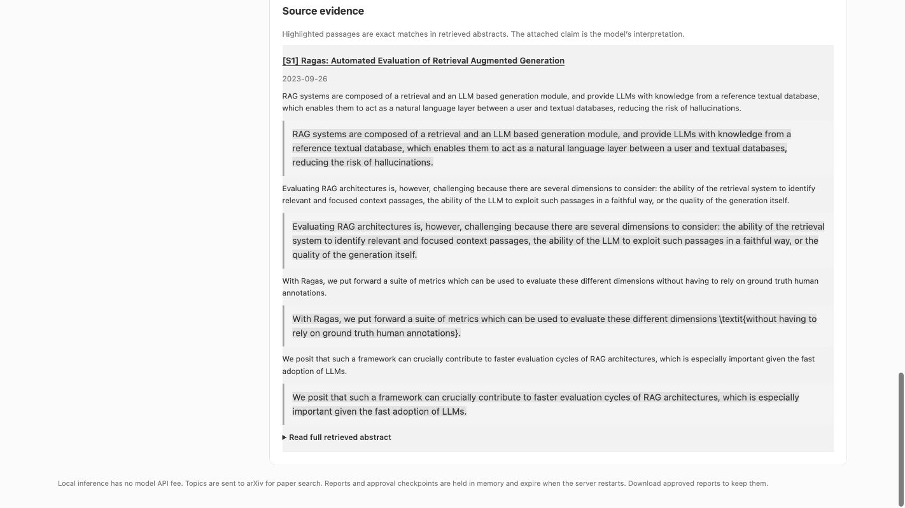
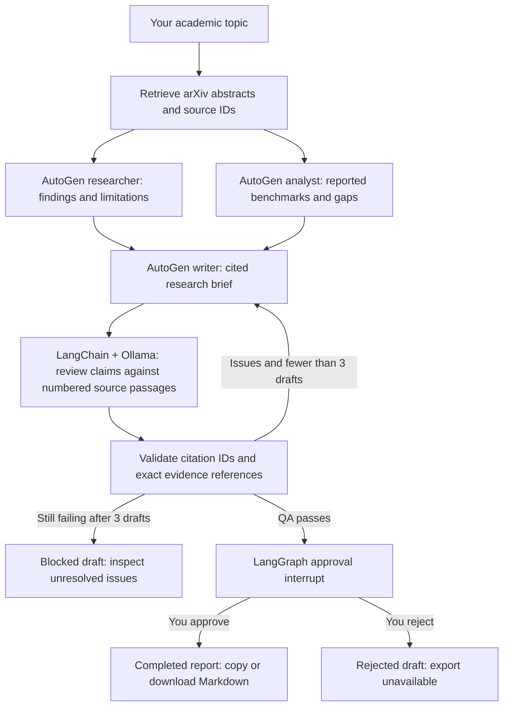
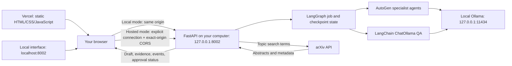
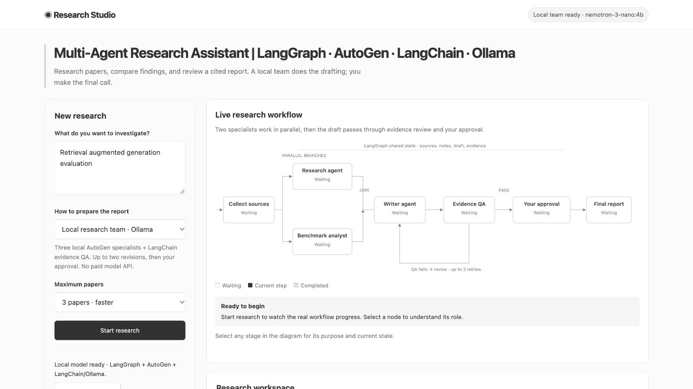

# Multi-Agent Research Assistant | LangGraph · AutoGen · LangChain · Ollama

**Research Studio**

**A local AI research team that turns academic paper abstracts into a cited brief you can inspect before approving.**

Research Studio retrieves real sources, runs research and benchmark-analysis agents, writes a structured report, checks supporting passages, and pauses for your decision. A live diagram shows which stage is running and what it is doing. The interface stays black, white, and gray.

**[Open the hosted interface](https://multi-agent-research-langgraph-autogen-langchain-ollama.vercel.app/)** · [How to run locally](#run-on-your-computer) · [How it works](#the-workflow) · [Architecture](docs/architecture.md)

> **Hosting arrangement:** Vercel serves the interface only. Start the Python backend and Ollama on your own computer to perform research. Opening the website alone does not give you a cloud-hosted AI model. There is no paid backend, Blob store, database subscription, or model API required for local mode.

## Why this project exists

An AI-generated report can sound convincing while hiding where its statements came from. This project makes the process inspectable. You can follow the stages, open the original abstracts, inspect selected supporting passages, review QA issues, and decide whether the report deserves approval.

The guiding idea is **evidence before confidence**. The application does not invent replacement sources when retrieval fails. It does not present a citation identifier or a model's QA verdict as proof that a claim is true. Approval enables a local export; it does not publish the report elsewhere.

This is useful for students exploring a field, developers comparing research approaches, and readers preparing an initial literature brief. It is an abstract-based discovery assistant, not a systematic review engine or an independent fact-checker.

## A first example

Ask about **“retrieval augmented generation evaluation”**, select **Local research team · Ollama**, and choose three papers. The researcher extracts findings and limitations. The analyst looks for reported benchmarks and missing measurements. The writer combines them into a cited brief. QA checks the brief against the original abstract passages. You inspect the evidence and approve or reject it.

A good output explains the available findings, identifies which paper supports them, and admits what the abstracts do not establish. A longer answer is not automatically a better answer.

## Screenshots and a guided tour

The recorded-report screenshots below use an **actual local Nemotron test with a previously retrieved Ragas abstract**. They show a read-only replay of the saved result for documentation, not a fresh live search or a newly approved report. The workspace screenshot shows the normal application.

### 1. Research workspace

Enter a focused topic, select a processing mode, choose up to eight papers, and start. Model readiness is checked through the backend. On the hosted interface, first connect the local backend.



### 2. Live workflow diagram

The diagram sits above the report workspace. The two specialist branches join at the writer. The return arrow shows the bounded revision loop. Black identifies the active stage; gray identifies completed stages. A stopped run is shown as blocked rather than falsely completed. Click a stage to read its role and current state. Small screens can scroll the diagram sideways.



### 3. Draft and human review

After automated QA passes, the local workflow pauses. Inspect the draft and evidence before clicking **Approve & enable export**. Rejection keeps final export unavailable. If QA still fails after the initial draft and two revisions, the draft stays blocked.



### 4. Original source evidence

Citation links lead to source records. Highlighted text is taken directly from retrieved abstracts. Expand a source to read its full retrieved abstract and open its arXiv page. The adjacent claim is a model interpretation and still needs your judgment.



## Concepts for beginners

| Term | Meaning in this project |
| --- | --- |
| LLM / model | The software that generates and reviews text. The default is `nemotron-3-nano:4b`. |
| Ollama | The local model server. It runs the downloaded model on your computer. |
| Agent | A model call given a specialist role and task. Three roles share the same model by default. |
| LangGraph | The workflow controller. It decides what runs together, what waits, when to revise, and when to pause. |
| AutoGen | The framework used to construct the researcher, analyst, and writer agents. |
| LangChain | The integration used to call Ollama for structured evidence review. |
| Shared state | The topic, original sources, notes, analysis, draft, QA results, and approval decision passed through the graph. |
| Backend | The Python/FastAPI program handling jobs, retrieval, model calls, and downloads. |
| Frontend | The HTML, CSS, and JavaScript interface in your browser. |
| arXiv | A repository of research papers and preprints. A listing does not establish peer review. |
| Abstract | A paper's short summary. This app does not download or read full PDFs. |
| Citation | An identifier such as `[S1]` linking a statement to a retrieved source. |
| QA | Automated quality review. It is a fallible model assessment plus deterministic reference checks. |
| Checkpoint | The saved graph state used to pause for approval and resume the same workflow. |

Using several agents does not mean three independently trained experts agreed. These are different tasks performed by the same configured model. The benefit is separation of responsibilities and an inspectable process.

## The workflow



1. **Collect:** search arXiv, normalize abstracts, and attach canonical IDs and URLs. Empty or failed searches stop the run.
2. **Research and analyze:** two graph nodes run concurrently and update different state keys. One extracts findings; the other focuses on reported measurements and missing evidence.
3. **Join and write:** the writer waits for both branches. It receives original abstracts as well as specialist notes, so upstream summaries are not its only evidence.
4. **Review:** `ChatOllama` produces structured QA output constrained by a Pydantic schema. It selects numbered source passages instead of copying quotations from memory.
5. **Validate:** Python resolves the selected passage IDs to original text, rejects unknown citations, checks quotes, and requires supporting evidence records for cited sources. This checks provenance; semantic support remains a model judgment.
6. **Revise:** the writer receives concrete QA feedback. There is an initial draft plus at most two revisions. Failed QA is never silently converted into approval.
7. **Pause:** passing QA reaches a real LangGraph `interrupt()` backed by an in-memory checkpointer.
8. **Decide:** your explicit approval resumes the graph. Approval enables a local Markdown download; rejection does not.

Parallel graph scheduling does not guarantee faster model inference. Ollama may serialize requests because of memory or server settings. The activity log shows real task events, not hidden chain-of-thought or an invented progress percentage.

## Backend and hosting architecture



**Vercel never connects to your private machine directly.** Your browser talks to the local backend after you click Connect. The Python backend talks to Ollama, so there is no need to expose Ollama itself to the hosted website or change `OLLAMA_ORIGINS` for this architecture.

The local backend accepts only explicitly allowed browser origins. It stays bound to loopback. No public tunnel is required. Browser local-network policies vary; if a browser blocks the hosted-to-local connection, use http://127.0.0.1:8002/ for the complete workflow.

## Run on your computer

### Prerequisites

- Python **3.11 or newer**, tested with Python 3.12.
- [Git](https://git-scm.com/downloads) to download the repository.
- [Ollama](https://ollama.com/download) installed and running.
- Enough memory and disk for your chosen local model. The default 4B quantized model download is several GB; inference also needs additional memory. Smaller source counts reduce latency and context size.
- Internet access for dependency installation, the initial model download, and arXiv retrieval.

### macOS / Linux

```sh
git clone https://github.com/Gayatri2502/multi-agent-research-assistant-langgraph-autogen-langchain-ollama.git
cd multi-agent-research-assistant-langgraph-autogen-langchain-ollama
python3 --version
python3 -m venv .venv
source .venv/bin/activate
python -m pip install -r requirements.txt
ollama pull nemotron-3-nano:4b
cp .env.example .env
python -m uvicorn research_assistant.app:app --host 127.0.0.1 --port 8002
```

Keep that terminal open. Open **http://127.0.0.1:8002/** in your browser. If Ollama is not running, open its app or run `ollama serve` in another terminal. If Ollama is already running, do not start a second server.

### Windows PowerShell

```powershell
git clone https://github.com/Gayatri2502/multi-agent-research-assistant-langgraph-autogen-langchain-ollama.git
cd multi-agent-research-assistant-langgraph-autogen-langchain-ollama
py -3.12 -m venv .venv
.\.venv\Scripts\python.exe -m pip install -r requirements.txt
ollama pull nemotron-3-nano:4b
Copy-Item .env.example .env
.\.venv\Scripts\python.exe -m uvicorn research_assistant.app:app --host 127.0.0.1 --port 8002
```

Using the virtual environment's Python directly avoids PowerShell activation-policy changes. You need access to the GitHub repository if it is private.

### Use the hosted interface

1. Start the same local backend and Ollama as above.
2. In `.env`, add the **exact origin** of the deployed website to the comma-separated allowlist. For example:

   ```dotenv
   RESEARCH_ALLOWED_ORIGINS=http://127.0.0.1:8002,http://localhost:8002,https://multi-agent-research-langgraph-autogen-langchain-ollama.vercel.app
   ```

3. Restart the backend after editing `.env`.
4. Open the deployed website and click **Connect local backend**.
5. If your browser asks for local network access, allow it for this site if you want the connection. If the browser does not support the connection, open the local interface instead.

A Vercel preview URL is a different origin. Add only preview origins you explicitly intend to trust. Do not use `*` and do not bind the backend to `0.0.0.0` merely to make the website work.

## Configuration

Copy `.env.example` to `.env`. Never commit `.env` or an API key.

| Variable | Default / purpose |
| --- | --- |
| `OLLAMA_MODEL` | `nemotron-3-nano:4b`; must be installed locally and not a cloud-only model alias. |
| `OLLAMA_BASE_URL` | `http://127.0.0.1:11434`; the backend's Ollama address. |
| `RESEARCH_ALLOWED_ORIGINS` | Exact browser origins allowed to call the local backend. Local origins are supplied in the example file. |
| `OPENAI_API_KEY` | Optional paid legacy mode. Leave empty for an all-local model workflow. |
| `OPENAI_MODEL` | Optional legacy mode's model, default `gpt-4o-mini`. |

Researcher/writer calls use temperature 0.2, a 16,384-token context setting, and up to 1,800 generated tokens per call. QA uses temperature 0 and up to 2,200 generated tokens. Output quality depends on evidence, prompts, and model capability, not only token limits. The model client has a 180-second request timeout; the overall local job has a 15-minute timeout.

## Research modes

| Mode | What happens | Cost / approval |
| --- | --- | --- |
| **Local research team · Ollama** | Parallel AutoGen specialists, writer, LangChain QA, bounded revisions, source passages | No model API fee; your approval required after QA passes. |
| **Collect paper abstracts** | Retrieves and organizes real abstracts without a model | No model API fee; no AI or approval claim. |
| **OpenAI research team** | Optional original sequential researcher → critic → writer implementation | Provider charges apply; shown only with a configured key. It has no local workflow's approval gate. |

The CLI/API also retain a fictional `demo` mode for deterministic tests. It is deliberately not a main UI research option. The CLI currently supports `demo`, `extractive`, and `ai`; use the web UI for the local approval workflow.

```sh
python -m research_assistant "RAG evaluation" --mode extractive --sources 3 --output reports/rag.md
```

## Free Vercel deployment

This repository deploys **only static files** from `dist/`. It does not deploy the Python backend, create functions, purchase a domain, provision paid storage, or enable AI Gateway. The user runs the same backend and local model independently of Vercel.

The [Vercel Hobby plan](https://vercel.com/docs/plans/hobby) is intended for personal, non-commercial use and has usage limits. Stay on Hobby and within its allowance. This is a no-paid-service architecture, not a promise of unlimited traffic or a guarantee that third-party pricing never changes. The project does not require a Pro upgrade or paid add-ons.

To deploy your own copy:

1. Push the repository to your GitHub account.
2. In Vercel, import it into your **Hobby** account/project.
3. Choose **Other** as the framework. The checked-in `vercel.json` sets:
   - Build command: `npm run build`
   - Install command: `echo No frontend dependencies`
   - Output directory: `dist`
4. Deploy. Add the assigned HTTPS origin to the local backend's allowlist.
5. Start the local backend and connect from the hosted page.

Node.js is needed only to build the static site, not to run the Python backend. There are no frontend npm dependencies.

```sh
npm run build
# Optional local static preview; connect to the separately running backend.
python3 -m http.server 4173 --directory dist
```

For that preview, add `http://localhost:4173` (or the exact origin you open) to the allowlist. The static site never includes `.env`, Python code, reports, or model weights.

## API reference

Interactive docs are at **http://127.0.0.1:8002/docs** after starting the backend.

| Endpoint | Purpose |
| --- | --- |
| `GET /health` | Process health and active jobs. |
| `GET /api/config` | Model readiness and optional OpenAI configuration; no secret values. |
| `POST /api/jobs` | Start a bounded background research job. |
| `GET /api/jobs/{id}` | Read status, actual events, sources, draft/report, notes, QA evidence, and attempt count. |
| `DELETE /api/jobs/{id}` | Cancel a run or discard a pending approval. |
| `POST /api/jobs/{id}/approval` | Approve or reject a QA-passed, paused local job. |
| `GET /api/jobs/{id}/report` | Download only a completed report. Pending, rejected, or blocked drafts return HTTP 409. |

Start a local job:

```sh
curl -X POST http://127.0.0.1:8002/api/jobs \
  -H 'Content-Type: application/json' \
  -d '{"topic":"RAG evaluation","mode":"local","limit":3}'
```

The returned `id` is used for polling and approval:

```sh
curl http://127.0.0.1:8002/api/jobs/JOB_ID
curl -X POST http://127.0.0.1:8002/api/jobs/JOB_ID/approval \
  -H 'Content-Type: application/json' -d '{"approved":true}'
```

The API defaults to extractive mode if `mode` is omitted. The UI prefers local mode when its model is ready.

Common states are `queued`, `running`, `awaiting_approval`, `completed`, `needs_review`, `rejected`, `failed`, and `cancelled`. HTTP 403 indicates an untrusted browser origin; 404 indicates an expired/missing job; 409 means an action is invalid for the current state; 429 means three jobs are already active; 503 means the selected provider is not configured or ready.

## Where the code lives

```text
research_assistant/
  app.py                 FastAPI endpoints, job limits, origin guard, approval/download gates
  local_workflow.py      Local agents, graph fan-out/join, QA schemas, exact passage lookup, interrupts
  workflow.py            arXiv retrieval, source parsing, citation checks, original modes
  index.html             UI, live SVG diagram, browser polling, source views, hosted connection
  __main__.py            CLI for original modes
scripts/build-static.mjs Copies the interface into a static-only Vercel build
tests/                   Workflow, API, origin, approval, and evidence validation tests
docs/architecture.md     Architecture decision and trade-offs
docs/screenshots/        Screenshots embedded in this guide
vercel.json              Static deployment settings
.env.example             Safe configuration template
```

## Limitations and privacy

- “Live arXiv” means a search at submission time, with a 15-minute cache. It is not a continuous news feed. Search uses up to 25 quoted topic words, returns up to eight abstracts, spaces requests at least three seconds apart, and retries transient errors.
- Each normalized abstract is bounded to 6,000 characters. Full PDFs, company websites, general web news, tables, figures, and peer-review status are not ingested or independently verified.
- Unknown citations and nonexistent passage references are rejected. A known citation and exact quote still do not prove a model's interpretation. QA can make false-positive or false-negative decisions.
- Jobs, checkpoint sessions, and pending approvals are in memory. Restarting or eviction loses them. At most 64 jobs and three active tasks are retained. Download approved reports to keep them.
- Run one Uvicorn worker, bound to loopback. There is no multi-user authentication, persistent database, or public backend hosting in this release.
- Topics are sent to arXiv. Local model prompts remain with your configured Ollama server. Optional OpenAI mode sends topic, source abstracts, and intermediate text to OpenAI and incurs provider usage.
- Browser recent history is held in session storage for that tab, including report text. It is not a durable archive and is not uploaded to Vercel by this application.

## Troubleshooting

| Symptom | What to do |
| --- | --- |
| Hosted page opens but cannot research | Start the local backend and Ollama, then click Connect local backend. Vercel hosts the interface only. |
| Local model unavailable | Run `ollama list`, check the model tag, install it if necessary, start Ollama, and click Check model setup. |
| Connection blocked / HTTP 403 | Add the exact website origin to `RESEARCH_ALLOWED_ORIGINS`, restart the backend, and permit browser local-network access if prompted. |
| Browser blocks HTTPS-to-local requests | Use the full local UI at `http://127.0.0.1:8002/`. Do not disable browser security. |
| arXiv unreachable / no papers | Retry later or shorten the topic. Do not interpret this as a completed research run. |
| Slow generation | Start with three sources, close other model workloads, and allow several minutes. Graph concurrency may still be serialized by Ollama. |
| QA blocks export | Inspect the actual issues and source evidence. The app does not automatically override failed QA. |
| Report disappears after restart | Expected for the in-memory backend. Run again and download approved results. |
| Vercel Git deployment is blocked by team configuration | The commit author must be associated with an authorized Vercel Git identity. Use the project owner’s deployment flow or correct your own Git identity. This does not require upgrading to a paid team. |
| Port 8002 already in use | Use the running instance or stop it from its original terminal before starting another. The hosted interface expects port 8002. |

## Tests and how to judge the application

```sh
python -m pip install -r requirements-dev.txt
python -m pytest -q
npm run build
```

Tests exercise the real LangGraph parallel join, actual interrupt/resume behavior, bounded revisions, forged quotations, unknown citations, API validation, origin rejection, local-network preflight, cancellation, approval/rejection, and download gating. Model responses are injected for deterministic unit tests; passing tests is not a benchmark of model accuracy.

A separate local integration check exercised real AutoGen + Ollama and LangChain QA using a previously retrieved source abstract, reached the approval checkpoint, and resumed rejection. Live arXiv availability is independent and can fail or time out.

Evaluate a report with five questions:

1. Are the retrieved papers relevant to the topic?
2. Does each factual claim have a citation to a source that actually supports it?
3. Are numerical claims faithful to the original abstract, without invented precision?
4. Does the report distinguish findings, hypotheses, and missing evidence?
5. Does the interface show real failures and blocked states honestly?

Future improvements include durable checkpoint storage, full-paper ingestion, evaluated source ranking, claim-level coverage metrics, and authenticated multi-user operation. They are not claimed as current features.

## Contributing

Create a branch, keep credentials and generated private reports out of Git, make a focused change, run tests and the static build, and document any changed behavior. Prefer source-backed tests over prompts that merely sound plausible. Repository visibility and access are controlled by its owner; this repository does not include a separate open-source license grant.

## References

- [LangGraph documentation](https://docs.langchain.com/oss/python/langgraph/overview)
- [LangGraph interrupts](https://reference.langchain.com/python/langgraph/types/interrupt)
- [AutoGen model clients](https://microsoft.github.io/autogen/stable/user-guide/agentchat-user-guide/tutorial/models.html)
- [LangChain ChatOllama](https://docs.langchain.com/oss/python/integrations/chat/ollama)
- [Ollama](https://ollama.com/)
- [arXiv API manual](https://info.arxiv.org/help/api/user-manual.html)
- [Vercel Hobby plan](https://vercel.com/docs/plans/hobby)

### Local workspace

The following screenshot shows the locally running workspace with its model setup and workflow controls; it does not show a completed research run.


